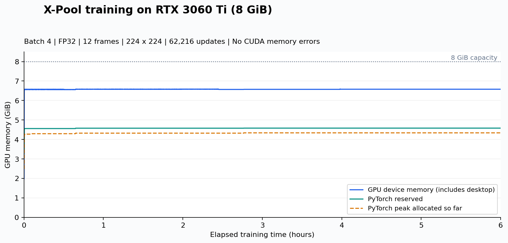
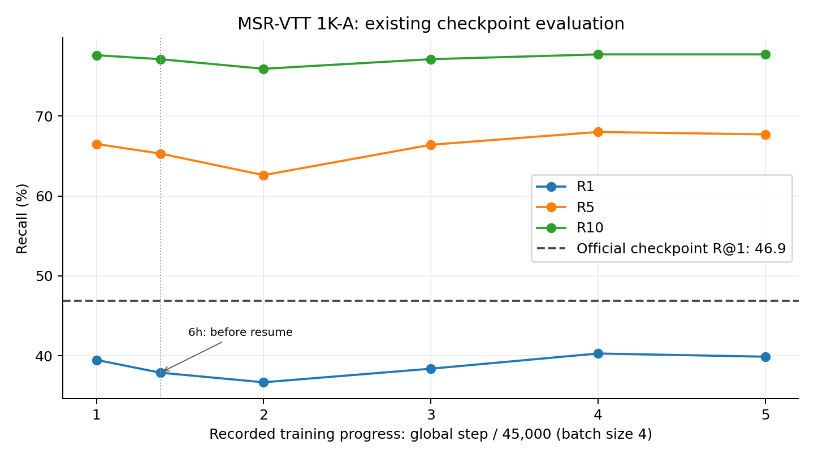
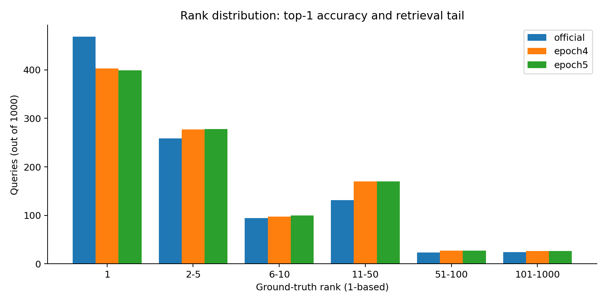
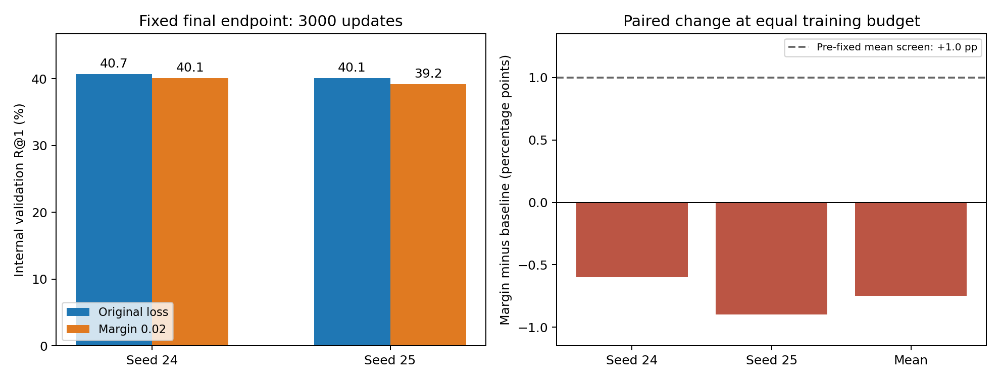

# X-Pool 실행·학습 재현 실험 보고서

실험 기간: 2026-11-07–2026-11-09. 본문 시각은 한국 표준시(KST, UTC+9)이며 원시 JSON의 시각은 UTC입니다.

## 확인된 결과

**공식 사전 학습 모델의 MSR-VTT 1K-A Recall@1 46.9%를 재현했다. RTX 3060 Ti 8GiB에서는 배치 4, FP32로 학습 스케줄을 끝까지 실행할 수 있었다. 직접 학습한 마지막 모델의 Recall@1은 39.9%로, 공식 모델보다 7.0%p 낮았다.**

따라서 현재 확보한 것은 공식 모델 평가의 재현 결과와 소형 GPU에서의 학습 가능성이다. 직접 학습한 모델이 원 논문의 학습 성능을 재현했다고 주장할 수는 없다. 다음 단계에서는 공식 체크포인트를 성능 기준으로 유지하고, 성능 차이의 원인과 검색 실패 사례를 조사하는 것이 적절하다.

11월 9일 후속 분석에서 기존 epoch 1·2·3·4·5와 초기 6시간 snapshot을 비교한 결과, 관측된 최고 R@1은 epoch 4의 **40.3%**였다. 공식 모델과의 차이는 여전히 **6.6%p**다. 아래 후속 분석에 전체 1,000개 질의 비교와 7건의 프레임·attention 관찰을 추가했다. 이 체크포인트 비교 단계에서는 추가 학습을 수행하지 않았다.

이후 별도의 학습 8K·내부 검증 1K에서 margin 0.02를 시험했다. 두 seed의 고정 3,000-update 비교에서 원래 loss 대비 R@1이 각각 −0.6%p, −0.9%p였고 평균 차이는 **−0.75%p**였다. 이 추가 학습 파일럿은 선별 기준을 통과하지 못해 채택을 보류했다. 공식 1K-A와 다른 평가이며, 아래에 별도 절로 기록했다.

| 검증 항목 | 결과 | 근거 |
| --- | --- | --- |
| 공식 체크포인트 평가 | R@1 46.9%, 정상 종료 | [평가 JSON](results/msrvtt9k/evaluation_report.json) |
| 8GiB GPU 학습 가능성 | 배치 4, FP32, 메모리 오류 미관측 | [누적 결과](results/msrvtt9k_split_training/completion_summary.json) |
| 전체 학습 스케줄 | 5 epochs에 해당하는 225,000 optimizer updates | [체크포인트 검증](results/msrvtt9k_split_training/checkpoint_verification.json) |
| 분할 실행 재개 | 모델·optimizer·scheduler·셔플·난수 상태 저장 | [GPU 비교](results/resume_gpu_verification.json) |
| 최종 모델 평가 | R@1 39.9%, 정상 종료 | [최종 평가 JSON](results/msrvtt9k_split_training/final_evaluation.json) |
| Cap4Video | 실행하지 않음 | 본 보고서는 X-Pool 실험만 다룸 |

## 환경과 데이터

| 항목 | 사용 조건 |
| --- | --- |
| GPU | NVIDIA GeForce RTX 3060 Ti, 8192MiB |
| 시스템 메모리 / 운영체제 | 32GB / Windows, PowerShell |
| Python | 3.9.18 |
| PyTorch / torchvision | 1.8.1+cu111 / 0.9.1+cu111 |
| Transformers / OpenCV | 4.6.1 / 4.5.3.56 |
| NumPy / pandas / SciPy | 1.22.4 / 1.3.5 / 1.7.3 |
| 기반 코드 | [공식 저장소](https://github.com/layer6ai-labs/xpool), 커밋 `bc88718199007d395136adc99a3e69adbee874a0` |
| CLIP | `openai/clip-vit-base-patch32`, revision `3d74acf9a28c67741b2f4f2ea7635f0aaf6f0268` |
| 학습 데이터 | MSR-VTT 9K, 9,000 videos / 180,000 caption-video pairs |
| 평가 데이터 | MSR-VTT 1K-A, 1,000 text-video pairs, text-to-video retrieval |
| 입력 | 영상당 12 frames, uniform sampling, 224×224 |

9K 학습 split과 1K-A 평가 split의 영상 ID는 서로 겹치지 않는다. 총 10,000개 영상 파일의 다운로드와 CRC32 확인 기록을 보관했다. [학습 manifest](results/dataset_manifests/msrvtt_9k_train_manifest.json), [평가 manifest](results/dataset_manifests/msrvtt_1ka_manifest.json), [CLIP manifest](results/dataset_manifests/clip_manifest.json)를 참고한다.

## 공식 모델 평가

원본 README에서 제공한 MSR-VTT 9K 체크포인트를 사용했다. 평가 배치만 4로 낮췄으며, 원본 README는 평가 배치 크기를 변경해도 결과가 달라지지 않는다고 설명한다. 학습 배치 크기를 바꾸는 경우와는 구분해야 한다.

| 항목 | 측정값 |
| --- | ---: |
| R@1 / R@5 / R@10 | 46.9% / 72.8% / 82.2% |
| MedR / MeanR | 2.0 / 14.291 |
| 실행 시간 | 138.704초, 약 2분 19초 |
| 장치 VRAM 최대 사용량 | 4461MiB, 약 4.36GiB |
| 종료 코드 | 0 |

이 결과는 제공된 공식 모델과 평가 데이터 준비가 정상임을 뒷받침한다. 직접 학습을 재현했다는 근거로 사용하지는 않는다. [평가 로그](results/msrvtt9k/evaluation.log)에 원래 출력이 있다.

## 직접 학습 설정

| 항목 | 값 |
| --- | --- |
| 학습 배치 / 정밀도 | 4 / FP32 |
| 학습 스케줄 | 5 epochs, epoch당 45,000 updates, 총 225,000 updates |
| CLIP learning rate | 1e-6 |
| 새 pooling 모듈 learning rate | 3e-5 |
| Weight decay / warmup proportion | 0.2 / 0.1 |
| Transformer dropout / heads | 0.3 / 1 |
| Seed / data workers | 24 / 2 |
| 학습 중 평가 | 비활성화 (`--evals_per_epoch=0`) |
| 메모리 절감 추가 기법 | AMP, gradient checkpointing, gradient accumulation 적용하지 않음 |

공식 README의 MSR-VTT 9K 학습 배치는 32다. 이 실험은 배치 4를 사용했으므로 contrastive loss의 배치 내 negative 구성이 다르다. 배치 차이, 검증에 따른 모델 선택 차이, 중단·재개 조건 등을 고려해야 하며, 한 번의 실행만으로 성능 차이의 원인을 특정할 수 없다.

또한 180,000 pairs를 기준으로 배치 32는 epoch당 5,625 updates, 배치 4는 45,000 updates로 8배 차이가 난다. 같은 epoch 수와 같은 learning rate를 사용해도 optimizer update 이력이 동등하지 않다. 후속 통제 실험에서는 negative 구성과 함께 학습률·업데이트 예산도 명시해야 한다.

## 실행 이력과 시간

| 실행 | 학습 시작(KST) | 학습·저장 시간 | 추가 updates | 누적 updates | 장치 VRAM 최대 |
| --- | --- | ---: | ---: | ---: | ---: |
| 초기 6시간 | 11/07 14:48경 | 21,603.938초 | 62,216 | 62,216 | 6751MiB / 6.59GiB |
| 두 번째 7시간 | 11/08 13:17경 | 25,207.640초 | 72,465 | 134,681 | 6748MiB / 6.59GiB |
| 남은 학습, 최대 10시간 예산 | 11/09 06:49경 | 32,122.453초 | 90,319 | 225,000 | 6646MiB / 6.49GiB |
| 합계 | — | **78,934.031초, 약 21시간 55분** | **225,000** | **225,000** | **6.59GiB** |

마지막 학습은 11월 9일 15:45경 정상 종료했다. 10시간 예산을 모두 사용하기 전에 학습 목표에 도달했다. 이후 최종 평가는 147.192초가 걸렸고 15:47경 완료됐다.

위 시간은 학습 프로파일 시작부터 마지막 체크포인트 저장까지다. 데이터 다운로드, 환경 구성, 세션 사이 대기 시간, 별도 평가, 짧은 준비 검증은 합계에 포함하지 않는다. 프로세스 전체 실행 시간은 각 `monitor_report.json`의 `wall_time_seconds`에서 별도로 확인할 수 있다.

전체 학습에서 900,000개의 caption-video pair를 처리했다. 이는 반복 처리 횟수이며 고유 샘플 수가 아니다. 전 구간 step CSV를 확인한 결과 step 1–225,000이 연속이고 모든 loss가 유한했다. 메모리 오류는 관측되지 않았다. 초기 짧은 배치 탐색 기록도 `results/vram_probe_b2_20261107_054714/`와 `results/vram_probe_b4_20261107_054714/`에 포함했다.

## VRAM 측정의 범위

`nvidia-smi`로 약 5초 간격의 장치 전체 사용량을 기록했다. **6.59GiB는 데스크톱과 다른 프로세스 사용량을 포함한 관측 최대값**이며 모델 tensor 메모리만의 값이 아니다. 샘플 사이의 순간 최대 사용량까지 보장하는 측정은 아니다.

초기 6시간 실행에서 PyTorch의 peak allocated는 약 4.34GiB, peak reserved는 약 4.58GiB였다. 전체 세션 중 장치 온도 최대값은 73.31°C였다. 이 수치는 위 설정에서의 결과이며, 배치 32나 다른 영상 길이에서의 실행 가능성은 검증하지 않았다.



## 분할 실행과 재개 검증

`ResumableBatchSampler`는 epoch의 실제 셔플 순열과 다음 완료할 배치 위치를 저장한다. worker prefetch는 완료 위치를 전진시키지 않고, optimizer update가 끝난 뒤에만 위치를 갱신한다. 샘플별 증강은 epoch와 index에 따른 seed를 사용한다.

체크포인트에는 모델, optimizer, scheduler, global step, Python·NumPy·PyTorch CPU·CUDA 난수 상태를 함께 저장한다. 임시 파일을 저장한 후 교체하고, 동일 실험 폴더에 두 학습 프로세스가 동시에 쓰지 못하도록 잠금을 둔다. 각 세션의 시간 제한은 재개할 때 새로 계산하며 기존 로그와 CSV는 보존한다.

**초기 6시간의 legacy 체크포인트에는 당시 셔플과 난수 상태가 없었다.** 따라서 62,216 step에서 처음 재개할 때부터 새로운 결정적 셔플 규칙을 적용했다. 이 전환을 가로지르는 학습이 처음부터 한 번에 연속 실행한 학습과 동일하다고 보장할 수 없다. 특히 중단된 epoch 2의 샘플 순서에 차이가 있을 수 있다. 이후 재개부터는 실제 셔플·난수 상태를 저장했다.

검증 범위는 다음과 같다.

- CPU 회귀 테스트 5개: 여러 번 재개, worker 수 변경, epoch 경계·마지막 짧은 배치, 세션 시간 초기화·로그 보존, legacy 전환, 설정 불일치와 동시 쓰기 거부를 검사했다. 공개용 클론에서도 5개 모두 통과했다([검증 기록](results/validation/cpu_resume_tests.json)). 새 클론에서 테스트 임시 폴더의 부모인 `outputs/`를 생성하도록 테스트 준비 코드를 보완했으며, 공개 정리 과정에서 모델·학습 코드는 변경하지 않았다.
- 실제 X-Pool GPU: 4 updates 연속 실행과 2 updates 후 재개한 2 updates를 비교했다. 416개 모델 tensor, optimizer, scheduler, 난수 및 셔플 상태가 비트 단위로 일치했다. 이는 짧은 비교 실험의 결과이며 전체 22시간 연속 실행과 비교한 것은 아니다.
- 최종 체크포인트: epoch 5, global step 225,000, `partial_epoch=false`, 다음 배치 45,000, optimizer와 scheduler의 step 일치, 모델 tensor의 유한값, 난수 상태 보존을 확인했다. `checkpoint-last.pth`와 epoch 5 파일의 SHA-256도 일치했다.

## 최종 검색 성능

동일한 1K-A text-to-video 평가 프로토콜에서 비교했다. Recall은 높을수록 좋고 MedR·MeanR은 낮을수록 좋다.

| 모델 | R@1 | R@5 | R@10 | MedR | MeanR |
| --- | ---: | ---: | ---: | ---: | ---: |
| 공식 9K 체크포인트 | 46.9% | 72.8% | 82.2% | 2.0 | 14.291 |
| 직접 학습한 배치 4, epoch 5 | 39.9% | 67.7% | 77.7% | 2.0 | 14.002 |

최종 모델은 R@1이 7.0%p 낮다. MeanR은 소폭 낮지만, 이것만으로 전체 검색 성능이 개선됐다고 볼 수 없다. 학습 중 평가를 끈 상태로 마지막 epoch를 평가했으므로 검증 성능으로 선택한 최적 모델의 결과도 아니다. [최종 평가 로그](results/msrvtt9k_split_training/final_evaluation.log)에 출력이 있다.

최종 파일은 원래 실험 PC의 `outputs/msrvtt9k_split_training/checkpoint-epoch5.pth`에 보관했다. 크기는 1,833,014,183 bytes이며 SHA-256은 다음과 같다. 이 파일은 Git 저장소에는 포함하지 않았다.

```text
cae2e62e18282026e2e6d9703cc8d0ef5e77f9b7dcb795685a088aec86ddfd8a
```

## 후속 분석: 중간 체크포인트와 검색 실패 사례

### 비교 방법과 실행 시간

공식 모델과 보존된 자체 모델 6개를 같은 MSR-VTT 1K-A에서 평가했다. 최초의 5개 평가에 더해 초기 6시간 폴더의 epoch 1 및 셔플 전환 직전 snapshot을 추가 확인했다. 각 평가의 배치 4·12프레임·seed 24와 원래 `test.py`의 forward·similarity·rank 계산을 유지했다. 최종 pooling의 기존 softmax 출력을 관찰해 정답·top-1 영상의 attention을 기록했으며 원래 반환값은 바꾸지 않았다.

공식 모델의 46.9%와 마지막 모델의 39.9%가 이전 결과와 일치했다. 각 모델에서 1,000개의 고유 영상·질의를 확인했고, 추출한 rank로 계산한 Recall이 원래 metric과 일치했다. 정답 score의 동률도 관측되지 않았다. [분석 코드 테스트 3개](results/checkpoint_analysis_20261109/validation/tests.json)는 rank 정의, query/video/attention 축, 동률 처리·entropy와 기존 결과 보존을 검사해 통과했다.

평가 프로세스 시간의 합은 **약 17분 6초**다. 이는 구현·분석·그림 검토·보고서 작성 시간이나 두 실행 묶음 사이 대기를 제외한 수치다. [첫 5회 실행](results/checkpoint_analysis_20261109/run_summary.json), [초기 이력 2회 실행](results/checkpoint_analysis_20261109/early_history_run_summary.json)에 개별 기록이 있다.

### 학습 시점에 따른 성능

| 보존 모델 | Global step | R@1 | R@5 | R@10 | MeanR |
| --- | ---: | ---: | ---: | ---: | ---: |
| 공식 체크포인트 | — | 46.9% | 72.8% | 82.2% | 14.291 |
| 자체 epoch 1 | 45,000 | 39.5% | 66.5% | 77.6% | 16.926 |
| 초기 6시간, 재개 전환 직전 | 62,216 | 37.9% | 65.3% | 77.1% | 18.138 |
| 자체 epoch 2 완료 | 90,000 | 36.7% | 62.6% | 75.9% | 16.852 |
| 자체 epoch 3 완료 | 135,000 | 38.4% | 66.4% | 77.1% | 15.601 |
| 자체 epoch 4 완료 | 180,000 | **40.3%** | **68.0%** | 77.7% | 14.264 |
| 자체 epoch 5 완료 | 225,000 | 39.9% | 67.7% | 77.7% | **14.002** |



epoch 4를 고르면 마지막 모델보다 R@1이 0.4%p 높지만 공식 모델과의 차이는 6.6%p 남는다. epoch 4→5에서 22개 정답이 top-1 밖으로 이동하고 18개가 새로 top-1에 들어왔다. 순감소 4건이며, 이를 과적합의 확정 증거로 해석하지 않았다.

공식 모델 대비 성능 차이는 epoch 1과 재개 전환 직전에도 존재했다. 따라서 셔플/RNG 전환 이후에만 차이가 발생했다는 설명은 맞지 않는다. 다만 전환이 이후 학습에 준 영향은 동일 조건의 연속 학습 대조군 없이는 분리할 수 없다. **epoch 4의 최고값은 동일 테스트셋에서 관찰한 비교 결과이며, 독립 validation으로 선택한 새 일반화 성능이 아니다.**

### 동일 질의에서 달라진 검색 결과

공식 모델과 epoch 4의 top-1 정답 여부를 비교했다.

| 질의 집합 | 개수 |
| --- | ---: |
| 둘 다 top-1 정답 | 352 |
| 공식 모델만 정답 | 117 |
| epoch 4만 정답 | 51 |
| 둘 다 top-1 실패 | 480 |

공식 모델의 469개 정답 중 117개를 놓치고 51개를 새로 맞혀 순차이는 66개다. 공식 모델만 맞힌 **117개 중 100개(85.5%)**는 epoch 4에서 정답이 2–5위, 8개는 6–10위, 나머지 9개는 11위 이하였다. 상위의 비슷한 후보를 세밀하게 구별하는 문제가 중요한 조사 대상이다.

전체 rank는 218개 질의에서 개선, 428개에서 동일, 354개에서 악화됐다. MeanR은 14.291→14.264로 거의 같지만 서로 다른 질의의 순위 등락이 상쇄된 값이다. R@1 개선으로 해석할 수 없다. [전체 질의 비교 CSV](results/checkpoint_analysis_20261109/rank_comparison.csv)와 [분석 JSON](results/checkpoint_analysis_20261109/analysis_summary.json)에 원시 집계가 있다.



### Attention에서 확인한 차이와 한계

프레임 attention의 normalized Shannon entropy를 사용했다. 0이면 한 프레임에 집중되고 1이면 12프레임에 균등하다. 아래 값은 정답 영상에 대한 평균이다.

| 질의 집합 | 공식 entropy | epoch 4 entropy | 공식 최대 가중치 평균 | epoch 4 최대 가중치 평균 |
| --- | ---: | ---: | ---: | ---: |
| 전체 1,000개 | 0.9432 | 0.9799 | 0.1631 | 0.1221 |
| 공식 모델만 top-1 정답인 117개 | 0.9126 | 0.9734 | 0.1889 | 0.1306 |
| epoch 4만 top-1 정답인 51개 | 0.9578 | 0.9808 | 0.1486 | 0.1202 |

자체 모델의 attention이 전반적으로 더 균등했다. 하지만 자체 모델만 맞힌 회복 사례에서도 같은 경향이 나타나므로, 균등함이 성능 저하의 원인이라고 결론 내리거나 단순 sharpening의 개선을 보장할 수 없다. 이 값은 학습된 attention의 관찰 지표이며 인과적 설명이 아니다.

### 프레임을 확인한 실패·회복 사례

고정된 rank 기반 규칙으로 7건을 선정하고 실제 평가의 224×224 crop을 적용한 표본 프레임을 로컬에서 확인했다. 세부 설명, 선정 규칙, 모델별 순위와 attention 그림은 [사례 보고서](results/checkpoint_analysis_20261109/casebook.md)에 있다.

- `video9347`: 쿠션을 보여 주는 정답 대신 비슷한 의상·배경에서 다른 제품을 보여 주는 영상을 top-1으로 검색했다. 세부 객체 구분의 사례다.
- `video9017`: 경주장 오토바이와 보조 인력이 있는 정답 대신 건물 부근의 오토바이 주행 영상을 검색했다. 공통 객체를 넘어 상황을 구분해야 한다.
- `video7558`: 소개와 컵 공연을 포함한 복합 질의에서 소개·발화 요소와 맞는 다른 영상이 더 높게 검색됐다. 공식 모델과 자체 모델의 최대 attention 프레임은 같아 단순한 최고 가중치 위치만으로 차이를 설명할 수 없었다.
- `video7215`: ‘person playing a game’ caption에 비해 표본 프레임은 인터뷰 형태가 대부분이었다. caption·샘플 커버리지 재검토 후보로 기록했으며 오라벨로 확정하거나 평가 데이터를 수정하지 않았다.

정성 사례는 전체 오류 비율의 추정 자료가 아니다. 음성과 전체 연속 영상은 검토하지 않았고, 모호한 caption의 다른 후보가 실제로 무관하다고 단정하지 않았다. 영상·프레임은 로컬에 보관하고 공개 저장소에는 ID와 attention 그래프를 추가했다.

## 개선안 파일럿: positive cosine margin 0.02

### 목적과 독립적인 fine-tuning 분할

앞선 분석에서 상위 후보 사이의 세부 구분이 중요하다는 관찰을 바탕으로, training similarity의 정답 대각선에서 cosine margin 0.02를 빼고 원래 symmetric CLIP loss를 계산하는 작은 변경을 시험했다. inference에서는 원래 cosine score와 ranking을 유지했다. 새 파라미터나 inference 연산은 추가하지 않았다.

기존 학습용 9K를 hash로 **학습 8,000개 영상 / 내부 검증 1,000개 영상**으로 나눴다. 학습 모집단은 160,000 caption-video pairs이며 검증 영상은 hash로 고정한 caption 1개씩을 사용한다. 검증 영상의 다른 caption도 학습에서 제외했다. 이 영상 ID들은 공식 1K-A와 겹치지 않는다.

기존 9K 체크포인트는 내부 검증 영상까지 이미 학습했으므로 초기화에 쓰지 않았다. 두 조건 모두 기본 CLIP와 원래의 새 pooling에서 시작해 전체 모델을 학습했다. 따라서 아래 수치는 **공식 1K-A의 46.9%·40.3%와 직접 비교하지 않는다.**

### 실행 전에 고정한 대조 조건

원래 loss와 margin 0.02를 seed 24·25에서 각각 실행했다. 조건당 FP32 배치 4, 3,000 updates, 12,000 pair 노출이며 같은 초기화·데이터 순서·증강 seed·learning rate·optimizer를 사용했다. CLIP LR은 1e-6, pooling LR은 3e-5, weight decay 0.2, warmup 300 updates 이후 cosine으로 3,000 updates에서 LR 0이 되도록 했다. validation은 0·1,000·2,000·3,000 updates에서 수행했다.

주 판정은 **동일한 최종 3,000 updates의 R@1 차이**다. 두 seed의 차이가 모두 양수이고 평균이 +1.0%p 이상일 때만 추가 연구를 고려하기로 실행 전 로컬 커밋 `4bd71f9`에 고정했다. 이는 실용적 선별 기준이며 통계적 유의성 기준이 아니다. 계획 원문과 해시는 [protocol.json](results/margin_pilot_20261109/protocol.json)에 있다.

### 결과

| 내부 검증, 최종 3,000 updates | 원래 loss R@1 | Margin 0.02 R@1 | 차이 |
| --- | ---: | ---: | ---: |
| Seed 24 | 40.7% | 40.1% | −0.6%p |
| Seed 25 | 40.1% | 39.2% | −0.9%p |
| 두 seed 평균 | **40.40%** | **39.65%** | **−0.75%p** |

두 seed의 R@1 표본 표준편차는 원래 loss 0.42%p, margin 0.64%p다. 신뢰구간으로 해석하지 않는다. 보조 metric인 R@5 평균은 66.50%→67.00%로 소폭 높았지만, R@10 평균은 76.70%→76.50%였다. 주 판정값인 R@1 개선으로 바꾸어 주장하지 않았다.



seed 24에서는 원래 loss만 top-1 정답인 질의가 26개, margin만 정답인 질의가 20개였다. seed 25에서는 각각 35개·26개였다. 동일한 1,000개 질의를 seed별로 평가한 것이므로 이를 독립적인 2,000개 질의로 간주하지 않는다. [검증 추이](results/margin_pilot_20261109/figures/validation_r1_curve.png)와 [전체 집계](results/margin_pilot_20261109/analysis_summary.json)에 세부 결과가 있다.

### 통제·구현 검증과 자원 사용

두 seed 모두 초기 pooling·기본 CLIP·logit scale, 전체 3,000 batch의 pair 순서 hash, 첫 3개 증강 입력 hash가 조건 간 일치했다. 실제로 접한 서로 다른 학습 영상은 seed 24에서 6,281개, seed 25에서 6,322개로 각각 동일했다. 모든 validation rank로 metric을 다시 계산해 대조했다.

4개 최종 체크포인트의 global step·optimizer·scheduler가 3,000과 일치했고, 모델 값이 모두 유한하며 pooling 파라미터 16개에 실제 optimizer update가 있음을 확인했다. loss의 margin 0 호환성, gradient 방향, 잘못된 입력 거부, 영상 ID 분리, 연속 실행과 청크 실행의 동일성을 검사한 CPU 테스트 5개도 통과했다.

4개 실행의 프로세스 시간 합은 **6,660.073초, 약 1시간 51분**이다. 준비·분석·보고서 작성 시간은 별도다. 5초 간격의 장치 전체 VRAM 관측 최대는 **6610MiB / 약 6.46GiB**, 온도 최대는 72.88°C이며 메모리 오류는 관측되지 않았다. 모델 가중치와 영상은 로컬에 보관하고 기록·hash를 공개했다.

### 판단과 한계

**고정 margin 0.02는 이번 파일럿의 선별 기준을 통과하지 못해 채택을 보류하고, 이 설정의 전체 학습으로 확대하지 않았다.** 결과를 본 뒤 margin이나 주 판정 시점을 바꾸지 않았다. seed 25에서 두 조건 모두 2,000 updates의 validation R@1이 더 높았다는 보조 정보도 기록했으나, 주 판정값 대신 사용하지 않았다.

조건당 12,000 pair 노출은 학습 caption-pair epoch의 7.5%다. 두 seed와 하나의 내부 분할만으로 다른 margin, 더 큰 negative 집합, 더 긴 학습의 효과를 결론 내릴 수 없다. 배치당 negative 3개라는 조건도 유지했다. 동일 영상의 batch 내 중복은 seed 24에서 조건별 1회, seed 25에서 0회였으며 원래 sampler의 의미상 false negative 가능성은 남아 있다.

가설 자체는 앞선 공식 테스트셋의 오류 관찰에서 나왔으므로 탐색적 실험이다. 이번 파일럿에서는 공식 1K-A에 추가 추론하거나 그 점수로 조건을 고르지 않았다. loss 변경이 세부 객체·행동 표현의 어떤 부분에 영향을 주었는지는 확인하지 않았다. [파일럿 상세·재현 절차](results/margin_pilot_20261109/README.md)를 참고한다.

## 다음 실험의 권장 순서

1. **공식 체크포인트를 성능 기준으로 고정한다.** 공식 46.9%와 자체 배치 4 실험을 별도 기준으로 유지한다. 자체 학습의 epoch 4는 이번 테스트셋 비교에서 40.3%, 마지막 epoch 5는 39.9%였다는 사실을 함께 기록한다.
2. **동일 예산의 통제 실험을 유지한다.** 별도 validation을 둔 margin 파일럿은 완료했으나 R@1 개선 기준을 통과하지 못했다. 이 설정의 장시간 학습은 보류한다. 다음 후보가 필요하면 초기화·분할·샘플 순서·업데이트 예산을 유지하고 negative 구성이나 학습률 조건 중 하나를 별도 가설로 비교한다. 이번 결과만으로 배치 크기가 원래 성능 차이의 유일한 원인이라고 단정하지 않는다.
3. **비슷한 상위 후보의 세부 객체·행동·상황 구분을 개선 가설로 삼는다.** 공식 모델만 맞힌 117건 중 100건이 자체 모델에서 2–5위였고, 관찰 사례에는 쿠션/다른 제품, 경주/일반 주행 구분 실패가 있었다. query의 세부 속성을 반영하는 pooling·reranking이나 구분하기 어려운 negative를 후보로 검토할 수 있다. 단순 attention 집중도 증가의 효과는 검증되지 않았다. Cap4Video나 새 caption generator는 별도의 baseline 검증으로 다룬다.

Gradient accumulation은 단순히 optimizer update 간격을 늘리는 구현만으로는 각 forward의 contrastive negative 수를 늘려 주지 않는다. 따라서 배치 4를 8번 누적했다는 이유만으로 논문의 배치 32와 동등하다고 간주하면 안 된다. 더 큰 negative 집합을 만드는 방식은 별도로 구현하고 검증해야 한다.

## 재현 절차

아래 명령은 사용 방법을 기록한 것이다. 최초 공개 이후 기존 모델 7개를 추가 평가했고, 이후 별도의 margin 파일럿에서 4개 짧은 학습을 수행했다. 기존 9K 학습 기록과 내부 검증 파일럿은 별도로 보존했다. margin 파일럿의 명령은 [해당 재현 절차](results/margin_pilot_20261109/README.md#재현)에 있다. 환경·데이터·공식 가중치 준비는 [README](README.md#준비)를 따른다.

공식 모델 평가:

```powershell
.\.venv\Scripts\python.exe evaluate_local.py
```

새로운 배치 4 학습을 처음부터 최대 7시간 실행하는 예시:

```powershell
.\.venv\Scripts\python.exe train.py `
  --exp_name=msrvtt9k_new_run --videos_dir=data/MSRVTT/vids `
  --dataset_name=MSRVTT --msrvtt_train_file=9k --huggingface `
  --batch_size=4 --num_workers=2 --num_epochs=5 `
  --noclip_lr=3e-5 --transformer_dropout=0.3 `
  --evals_per_epoch=0 --log_step=100 --no_tensorboard `
  --profile_training --max_train_seconds=25200
```

위 새 실험을 저장된 위치부터 최대 10시간 더 실행하는 예시:

```powershell
.\.venv\Scripts\python.exe run_training_session.py --exp-name msrvtt9k_new_run --hours 10
```

실측 전체 시간은 약 22시간이므로 새 학습이 7+10시간만으로 끝난다고 가정하면 안 된다. 기록된 이번 실험은 그 전에 수행한 6시간을 포함해 완료했다. 최대 5 epoch까지만 학습하고, 시간 제한이 먼저 도달하면 다음 세션으로 이어간다.

완료된 로컬 모델 평가 예시(해당 가중치를 별도로 준비해야 함):

```powershell
.\.venv\Scripts\python.exe test.py `
  --exp_name=msrvtt9k_split_training --videos_dir=data/MSRVTT/vids `
  --dataset_name=MSRVTT --msrvtt_train_file=9k --huggingface `
  --batch_size=4 --num_workers=2 --load_epoch=5 --no_tensorboard
```

재개 회귀 테스트:

```powershell
.\.venv\Scripts\python.exe -m unittest discover -s tests -v
```

## 공개 기록의 구성과 한계

- `results/msrvtt9k/`: 공식 모델 평가 결과와 로그.
- `results/msrvtt9k_train_vram_20261107_054714/`: 초기 6시간 실행의 요약, step·GPU CSV, 로그와 그래프.
- `results/msrvtt9k_split_training/`: 7시간·최종 실행의 기록, 최종 평가, 체크포인트 검증과 전체 요약. 루트의 `session_summary.json`과 step CSV는 7시간 실행 기록이며 최신 프로파일은 최종 실행 기록이다. 추가 세션의 상세 기록은 `sessions/`에 있다.
- `results/resume_gpu_verification.json`, `results/resume_gpu_*`, `results/resume_session_entry_test/`: 재개 구현 검증 기록.
- `results/dataset_manifests/`: 영상·CLIP 다운로드 확인 자료. 영상이나 모델 가중치 자체는 포함하지 않는다.
- `results/validation/`: 공개용 복사본에서 수행한 CPU 회귀 테스트 기록.
- `results/checkpoint_analysis_20261109/`: 보존 모델 7개 추가 평가, 전체 질의의 rank·상위 후보·attention, 비교 그래프와 7건의 정성 사례.
- `results/margin_pilot_20261109/`: 사전 고정한 8K/1K 내부 분할, margin 0.02의 2-seed 대조 실험, 검증 추이·순위·통제 hash와 채택 보류 결과.
- `results/artifact_manifest.json`: 원본·공개 사본의 해시와 경로 치환 여부.

공개 사본의 로그·JSON에서는 개인 PC의 절대 경로를 치환했다. 수치와 원시 CSV는 유지했다. 모델 가중치, 영상, 가상환경은 로컬에만 보관했다. 일부 보조 패키지는 `requirements-local.txt`에서 버전을 고정하지 않았으며, 다른 GPU·드라이버·라이브러리에서 비트 단위 동일성을 보장하지 않는다. 여러 seed의 평균이나 통계적 유의성 실험도 수행하지 않았다.
