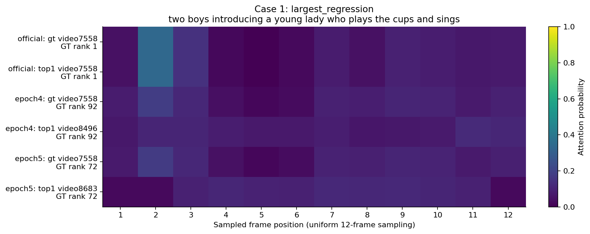
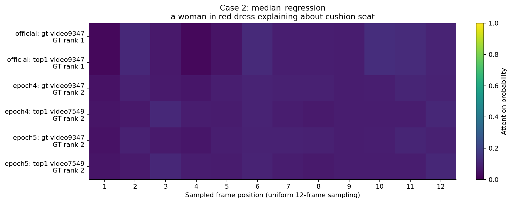
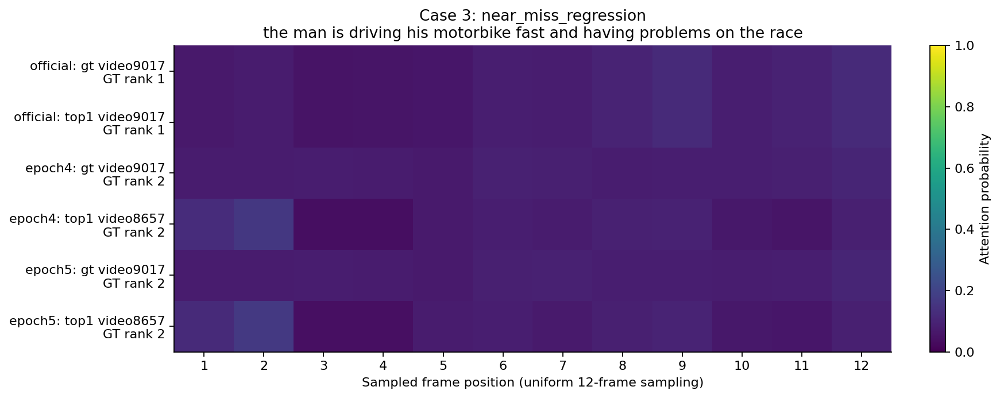
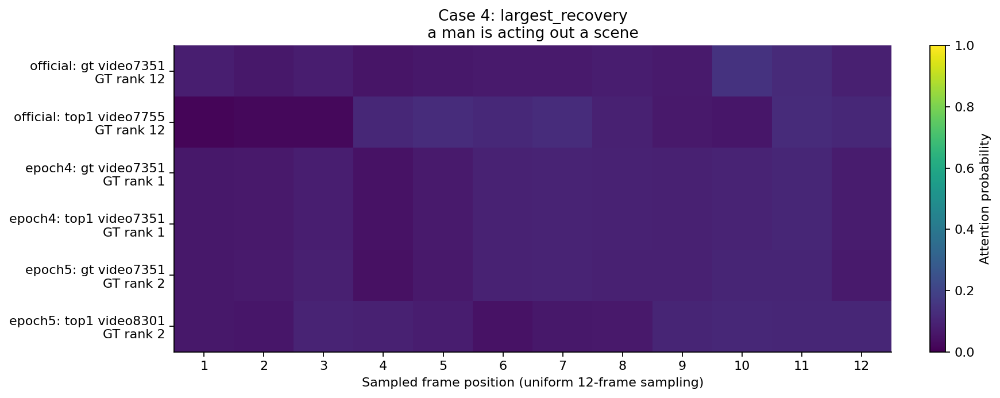
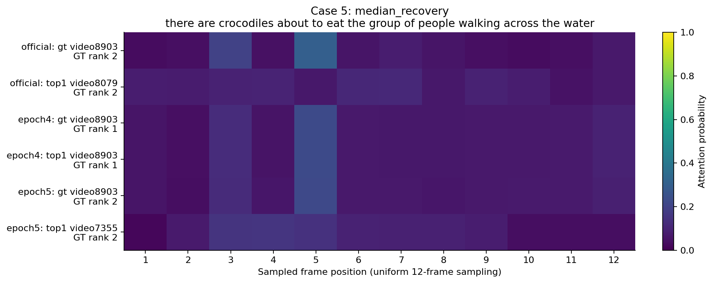
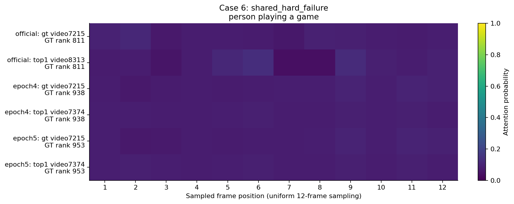
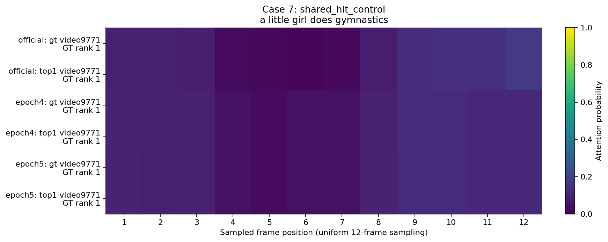

# 검색 실패·회복 사례 7건

공식 모델, 자체 학습 epoch 4, 마지막 epoch 5를 같은 질의에서 비교했다. **정답 영상은 벤치마크의 지정 정답**을 뜻한다. 다른 영상이 의미상 관련 있는지와는 구분해야 한다.

선정은 [summarize_retrieval.py](../../summarize_retrieval.py)의 고정 규칙을 사용했다. 공식 모델만 맞힌 질의의 최대·중간·최소 순위 하락, 자체 모델만 맞힌 질의의 최대·중간 회복, 공통 상위 10위 밖 실패, 공통 정답 대조 사례를 뽑았다. 전체 실패의 대표 표본이나 빈도 추정용 표본은 아니다. [casebook.json](casebook.json)에 선정 규칙과 원시 수치가 있다.

각 영상에서 원래 평가와 같은 균등 12프레임을 추출하고 그중 6개 위치(1, 3, 5, 7, 9, 12)를 로컬 contact sheet로 관찰했다. 실제 평가의 resize·224×224 center crop을 적용하고 CLIP 정규화만 시각화를 위해 되돌렸다. 음성이나 전체 연속 재생은 검토하지 않았다. 정성 해석은 아래 관찰 범위에 한정한다. 공개 저장소에는 영상·추출 프레임 대신 ID, [샘플 frame index](case_frame_indices.json), attention 그래프를 포함했다. 원본 영상을 갖춘 환경에서는 `render_analysis_frames.py`로 로컬 그림을 다시 만들 수 있다.

| 사례 | 정답 영상 | 공식 rank | epoch 4 rank | epoch 5 rank | 관찰한 쟁점 |
| --- | --- | ---: | ---: | ---: | --- |
| 1 | video7558 | 1 | 92 | 72 | 소개와 컵 공연이 함께 포함된 복합 질의 |
| 2 | video9347 | 1 | 2 | 2 | 비슷한 의상·배경에서 쿠션과 다른 제품 구분 |
| 3 | video9017 | 1 | 2 | 2 | 오토바이 객체는 같지만 경주·문제 상황이 다름 |
| 4 | video7351 | 12 | 1 | 2 | 넓은 의미의 ‘연기’ 질의와 일대일 정답의 모호성 |
| 5 | video8903 | 2 | 1 | 2 | 물·파충류·사람의 행동을 함께 만족하는지 |
| 6 | video7215 | 811 | 938 | 953 | ‘게임’ caption과 샘플 프레임의 시각적 근거 불일치 가능성 |
| 7 | video9771 | 1 | 1 | 1 | 체조 장면 공통 정답 대조 사례 |

## 1. 복합 장면 질의 — video7558

질의는 두 진행자가 여성을 소개하고, 여성이 컵을 이용해 공연하며 노래한다는 여러 요소를 포함한다. 표본 프레임에는 앞부분의 무대 소개와 뒷부분의 컵 공연이 보인다. epoch 4의 top-1은 마이크를 들고 카메라를 향해 말하는 `video8496`, epoch 5의 top-1은 두 진행자가 소개하는 형태의 `video8683`였다. 질의의 일부 요소와 맞는 영상이 전체 조건을 만족하는 정답보다 높게 검색된 사례로 해석할 수 있다.

정답 영상의 최대 attention 위치는 세 모델 모두 2번째 프레임이다. 최대 가중치는 공식 0.3391, epoch 4 0.1805, epoch 5 0.1744다. 따라서 공식 모델이 다른 최고 가중치 프레임을 골랐기 때문에 맞혔다고 설명할 수는 없다. 다른 프레임의 가중치와 CLIP 표현·pooling 파라미터가 함께 작용한 결과다.

## 2. 비슷한 배경 속 객체 구분 — video9347

질의는 붉은 옷을 입은 인물이 쿠션 좌석을 설명하는 장면이다. 정답 표본에는 쿠션을 들어 보여 주는 모습이 있다. 자체 모델들의 top-1 `video7549`는 의상·실내 배경·앉은 구도가 매우 유사하지만 다른 제품과 봉투를 보여 준다. 배경과 구도보다 질의의 구체 객체를 구별해야 하는 사례다.

epoch 4의 정답 점수는 top-1보다 cosine similarity 0.01484 낮았고, 정답은 2위였다. 정답 영상의 normalized attention entropy는 공식 0.956, epoch 4 0.993이다. 이것은 프레임 가중치의 차이를 보여 주지만, 객체 구분 실패의 원인이 attention 하나라고 증명하지는 않는다.

## 3. 같은 객체, 다른 행동·상황 — video9017

정답 표본에는 경주장, 오토바이, 보조 인력이 보인다. 자체 모델들의 top-1 `video8657`에는 오토바이를 타고 건물 부근으로 오는 장면이 보인다. 두 영상 모두 오토바이라는 객체를 포함하지만, 질의의 ‘경주’와 ‘문제가 생김’이라는 상황은 다르다. epoch 4의 정답은 2위이고 top-1과의 점수 차이는 0.00703이다.

이는 상위 후보를 구체 행동·상황으로 다시 구분하는 개선 가설과 연결된다. 현재 [pooling 코드](../../modules/transformer.py)는 순서 위치를 명시적으로 더하지 않은 프레임 집합에 cross-attention을 적용한다. 다만 이 한 사례만으로 시간 순서 정보 부재가 오류의 원인이라고 결론 내릴 수는 없다.

## 4. 넓은 질의와 정답 정의 — video7351

질의는 ‘a man is acting out a scene’으로 구체 대상이나 행동 조건이 적다. 정답 표본에는 무대 위에서 몸짓하는 인물이 보인다. 공식 모델의 top-1 `video7755`와 epoch 5의 top-1 `video8301` 역시 카메라를 향해 말하거나 몸짓하는 인물을 포함한다. 질의가 넓어 여러 영상이 관련될 가능성을 고려해야 한다.

epoch 4에서는 정답 1위지만 epoch 5에서는 2위다. epoch 5의 top-1과 정답 점수 차이는 0.00129다. 지정 정답 기준의 순위는 명확하되, 모든 오답을 의미상 완전히 무관한 영상으로 분류하지 않았다. 다른 후보의 관련성을 확인하려면 별도 relevance annotation이 필요하다.

## 5. 여러 의미 요소의 결합 — video8903

정답 표본은 물 위를 건너는 사람들과 악어가 나오는 애니메이션이다. 공식 top-1 `video8079`는 물에서 카약을 타는 장면이고, epoch 5 top-1 `video7355`는 공룡 형태가 포함된 영화 홍보 그래픽이다. 각각 물·사람, 파충류 모양 같은 일부 단서는 있으나 질의 전체의 관계·행동을 만족하는지는 다르다. epoch 4에서는 정답을 1위로 검색했다.

이 회복 사례에서도 epoch 4의 attention entropy(0.949)는 공식 모델(0.867)보다 높다. 더 균등한 attention이 반드시 오답을 만든다는 설명에 대한 반례다.

## 6. caption·샘플 커버리지 검토 후보 — video7215

질의는 ‘person playing a game’이다. 정답 표본은 짧은 다른 장면과 인터뷰 형태의 프레임이 대부분이며, 선택한 이미지에서는 사람이 게임을 하는 직접적인 시각 근거가 뚜렷하지 않다. 공식 top-1 `video8313`, 자체 모델 top-1 `video7374`에서는 실제 게임 화면이 보인다.

caption이 부정확한지, 게임 관련 순간이 균등 샘플 사이에 있는지, 다른 맥락이 필요한지는 현재 관찰만으로 확정하지 않았다. **데이터·샘플 커버리지 재검토 플래그**를 붙일 사례이며, 벤치마크 라벨이나 평가 데이터를 수정하지 않았다. 이 사례를 모델 구조의 문제로만 해석해서는 안 된다.

## 7. 공통 정답 대조 — video9771

체조 시설과 체조 동작이 표본 프레임에서 보이며 세 모델 모두 정답 1위다. 정답 attention entropy는 공식 0.917, epoch 4 0.967, epoch 5 0.969다. 자체 모델이 더 균등한 attention을 가지면서도 정답을 유지하는 또 다른 사례다.

## 해석의 범위

위 사례는 세부 객체·상황 구분, 복합 질의의 부분 일치, 넓거나 모호한 caption, 샘플 커버리지라는 조사 방향을 제시한다. 이 7건의 관찰로 전체 실패 유형의 비중을 추정하거나 특정 수정의 성능 향상을 예측하지 않는다. 새 학습이나 attention 변경 실험은 수행하지 않았고, 원래 forward에서 계산된 attention만 관찰했다.
