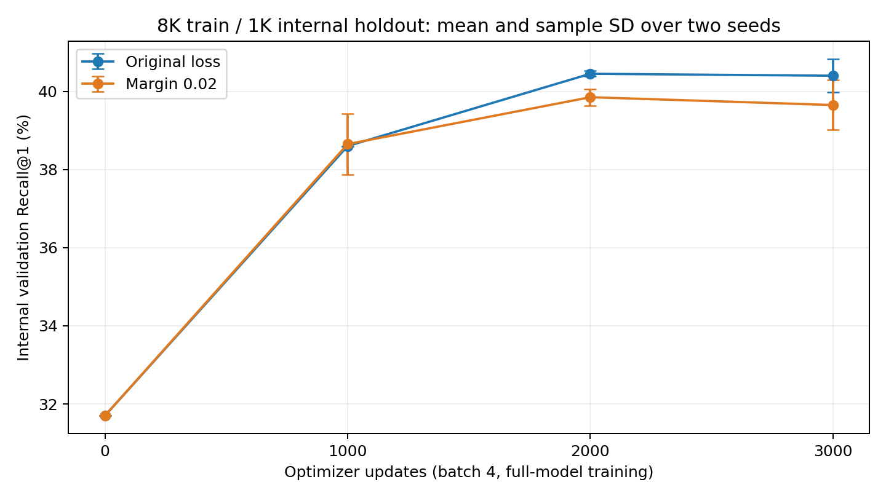
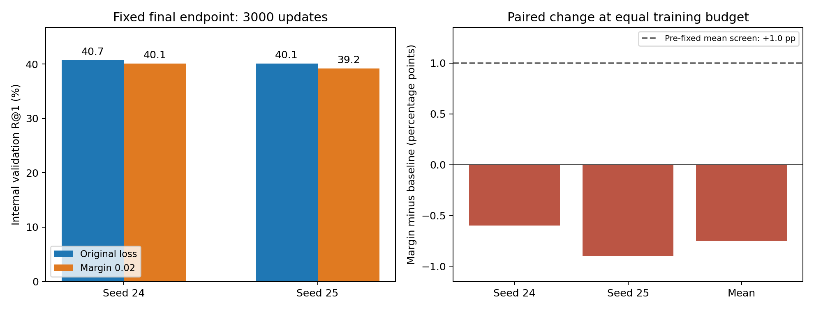

# Positive cosine margin 파일럿

이 실험은 X-Pool의 원래 대조 손실에 작은 margin을 추가하면 비슷한 후보의 순위를 더 잘 구분할 수 있는지 확인하는 짧은 비교다. **학습 8K·내부 검증 1K 기준이며 공식 MSR-VTT 1K-A 테스트 결과가 아니다.**

**결과: margin 0.02는 이번 고정 예산에서 채택을 보류한다.** 최종 R@1이 두 seed 모두 낮았고 평균 차이는 −0.75%p였다. 실행 전에 정한 선별 기준을 통과하지 못해 이 설정의 전체 학습으로 확대하지 않았다.

| 최종 3,000 updates | 원래 loss R@1 | Margin 0.02 R@1 | 차이 |
| --- | ---: | ---: | ---: |
| Seed 24 | 40.7% | 40.1% | −0.6%p |
| Seed 25 | 40.1% | 39.2% | −0.9%p |
| 두 seed 평균 | **40.40%** | **39.65%** | **−0.75%p** |

R@1의 seed 간 sample SD는 원래 loss 0.42%p, margin 0.64%p다. 이는 신뢰구간이 아니다. R@5 평균은 66.50%→67.00%로 소폭 높았지만, 사전에 정한 주 판정값인 R@1 개선으로 간주하지 않았다. R@10 평균은 76.70%→76.50%였다.





- [실행 전에 고정한 실험 계획](protocol.json)
- [학습 영상 ID 8,000개](train_video_ids.txt) · [내부 검증 질의 1,000개](validation.csv)
- [최종 분석 JSON](analysis_summary.json) · [실행 시간·GPU 기록](run_summary.json)
- [전체 검증 성능 추이 CSV](validation_curve.csv)
- [seed 24 질의별 비교](paired_validation_seed24.csv) · [seed 25 질의별 비교](paired_validation_seed25.csv)
- [코드 테스트 5개](validation/tests.json)
- [전체 실험 보고서](../../report.md)
- [공개 파일 해시와 구현 버전](artifact_manifest.json)

## 실행·통제 검증 결과

4개 실행이 모두 exit code 0으로 종료했다. 총 프로세스 시간은 **6,660.073초, 약 1시간 51분**이다. 준비·분석·보고서 작업 시간은 별도다. 장치 전체 VRAM 관측 최대는 **6610MiB / 약 6.46GiB**, 온도 최대는 72.88°C였고 메모리 오류는 관측되지 않았다. VRAM은 약 5초 간격 측정이며 데스크톱 등 다른 프로세스를 포함한다.

두 seed에서 초기화·3,000 batch 순서 hash·처음 3개 증강 입력 hash가 각각 일치했다. 각 조건은 seed 24에서 6,281개, seed 25에서 6,322개의 서로 다른 학습 영상을 접했다. 모든 최종 체크포인트에서 optimizer·scheduler 3,000 updates, 유한한 모델 값, 실제 갱신된 pooling 파라미터 16개를 확인했다. 모든 단계의 16,000개 validation rank에서 metric을 다시 계산해 기록과 대조했다.

동일 영상이 한 학습 batch에 중복된 경우는 seed 24의 두 조건에서 각각 1회, seed 25에서는 0회였다. 원래 sampler를 유지한 결과이며 두 조건에서 동일하다. seed 25에서는 두 조건 모두 2,000 updates의 validation R@1이 가장 높았지만, 이 보조 시점으로 주 판정값을 바꾸지 않았다.

최종 top-1의 paired 결과는 seed 24에서 원래 loss만 정답 26건·margin만 정답 20건, seed 25에서 각각 35건·26건이었다. 이는 같은 1,000개 검증 질의를 seed별로 다시 평가한 결과이며, 서로 독립인 2,000개 질의로 간주하지 않는다.

## 변경한 부분

[MarginCLIPLoss](../../modules/loss.py)는 training similarity matrix `S`의 정답 대각선에서 `m=0.02`를 빼고 원래 symmetric CLIP loss를 계산한다.

```text
L_margin = CLIPLoss(S - m * I, logit_scale)
baseline: m = 0
candidate: m = 0.02
```

정답에 더 큰 score 차이를 요구하려는 가설이다. 새 학습 파라미터나 inference 연산은 추가하지 않았고, 검증에서는 원래 cosine similarity와 `t2v_metrics`를 그대로 사용했다. 기본 `LossFactory`와 기존 `train.py`의 기본 동작은 유지했다. 새 손실은 이 파일럿 entry point에서 명시적으로 선택한다. margin 0일 때 원래 loss와 gradient가 정확히 일치하는지 테스트했다.

이 가설은 앞선 검색 실패 분석에서 공식 모델만 맞힌 117개 중 100개의 정답이 자체 모델에서 2–5위였다는 관찰에서 출발했다. 그러나 margin을 추가하는 것 자체가 실제로 세부 객체·행동 표현을 개선한다고 보장하지는 않는다.

## 데이터와 초기화

기존 9K 학습 split의 영상 ID를 `SHA256(split|24|video_id)`로 정렬해 1,000개를 내부 검증에 배정했다. 나머지 8,000개 영상의 160,000 caption-video pairs가 학습 모집단이다. 검증 영상은 각 20개 caption 중 hash로 고정한 1개만 평가에 사용하며, 검증 영상의 다른 caption도 학습에 포함하지 않는다. 공식 1K-A와 영상 ID가 겹치지 않음을 확인했다.

두 조건 모두 기본 `openai/clip-vit-base-patch32`와 원래의 새 X-Pool pooling에서 시작했다. 기존 전체 9K 학습 체크포인트는 내부 검증 영상도 학습했으므로 초기화에 사용하지 않았다. 기반 CLIP의 SHA-256과 split 파일 해시는 protocol에 기록했다. 이는 fine-tuning의 영상 ID 분리이며 CLIP 사전 학습 데이터까지 미관측임을 보장하는 주장은 아니다.

## 고정한 조건과 판정

| 항목 | 설정 |
| --- | --- |
| 비교 | 원래 CLIP loss / positive cosine margin 0.02 |
| Seed | 24, 25; 총 4개 실행 |
| 학습 | 전체 CLIP와 pooling을 함께 학습, FP32, 배치 4 |
| 입력 | 12 uniform frames, 224×224, 원래 train/test transforms |
| 예산 | 조건·seed당 3,000 optimizer updates, 12,000 pair 노출 |
| Learning rate | CLIP 1e-6 / pooling 3e-5 |
| Optimizer | 원래 AdamW, weight decay 0.2, grad norm clip 1.0 |
| Scheduler | 300 updates warmup, 3,000 updates에서 0이 되는 cosine |
| 검증 시점 | 0 / 1,000 / 2,000 / 3,000 updates |
| 실행 순서 | seed24 baseline → margin → seed25 margin → baseline |
| 주 판정값 | 동일한 최종 3,000 updates의 검증 R@1 차이 |

**두 seed 모두 R@1 차이가 양수이고 평균 차이가 +1.0%p 이상**일 때만 추가 연구를 고려하기로 실행 전에 고정했다. 이는 실용적 선별 기준이며 통계적 유의성 기준이 아니다. 가장 높은 validation checkpoint는 보조 정보이며 주 판정에 대신 사용하지 않는다. 실험 계획과 학습 코드는 학습 시작 전 로컬 커밋 `4bd71f9`에 고정했다.

공정성 확인을 위해 같은 seed 안에서 기본 CLIP 파일·초기 pooling·초기 logit scale, 전체 3,000 batch의 pair 순서 hash, 처음 3개 증강 입력 hash를 비교한다. validation 사이에 학습 난수 상태를 복원하고, 기존의 seed 기반 데이터 증강과 sampler 완료 위치를 유지한다. 원래 caption-pair sampler에서 동일 영상이 한 batch에 중복되는 경우는 제거하지 않고 횟수를 기록한다. 두 조건의 해당 입력은 같으며, 이 의미상 false negative 가능성은 제한 사항이다.

## 해석의 범위

조건당 12,000 pair 노출은 160,000-pair 학습 epoch의 7.5%다. 두 seed와 하나의 내부 분할만 사용했고, 공식 1K-A는 이번 파일럿의 평가나 조건 선택에 사용하지 않았다. 가설 자체는 이전 테스트셋의 오류 관찰에서 나왔으므로 탐색적 실험이다.

학습 loss는 조건별로 목적식이 다르므로 값의 크기를 직접 성능 비교에 사용하지 않는다. validation loss는 두 조건 모두 원래 margin-free CLIP loss로 계산하며, 이는 평가 batch 4의 대조 손실이다. 주 판정은 1,000개 후보 전체에 대한 retrieval R@1이다.

이 실험만으로 다른 margin, 더 큰 batch, 더 긴 학습의 결과를 결론 내리지 않는다. 영상·모델 가중치는 로컬에 보관하고, 공개 기록에는 설정·측정·rank·hash만 포함한다.

## 재현

측정한 학습 구현은 [커밋 4bd71f9](https://github.com/ApeachLicense/X_Pool_Experiment/commit/4bd71f956558410ece4d0050396c4a6c66c4b570)에 있다. 학습 종료 후 공개 entry point에 새 결과 폴더 이름을 선택하는 `--experiment-name` 옵션만 보완했다. 모델·loss·학습 조건은 바꾸지 않았다. [CLI 확인](validation/cli_checks.json)에서 옵션과 잘못된 경로 거부를 검사했다.

영상과 기본 CLIP을 갖춘 기존 실험 폴더를 `--source-root`에 지정한다. 아래 예시는 원래 기록을 덮어쓰지 않는 새 이름으로 같은 조건을 준비·실행한다. 학습은 Python 3.9.18 / PyTorch 1.8.1+cu111 환경을 사용한다.

```powershell
.\.venv\Scripts\python.exe margin_pilot.py prepare `
  --source-root ..\xpool --experiment-name margin_pilot_recheck
.\.venv\Scripts\python.exe margin_pilot.py run `
  --source-root ..\xpool --experiment-name margin_pilot_recheck
.\.venv\Scripts\python.exe summarize_margin_pilot.py analyze `
  --experiment-name margin_pilot_recheck
```

그림은 별도 plotting 환경에서 생성할 수 있다. [환경 기록](plotting_environment.json)은 Python 3.11.4, matplotlib 3.10.1, NumPy 2.2.4다.

```powershell
python summarize_margin_pilot.py plot --experiment-name margin_pilot_recheck
```

학습 체크포인트는 `outputs/<experiment-name>/<arm>/`에, 공개 가능한 기록은 `results/<experiment-name>/`에 저장한다. 기본 이름은 이번 측정 기록을 보호하므로 이미 실행 기록이 있으면 재실행을 거부한다.
